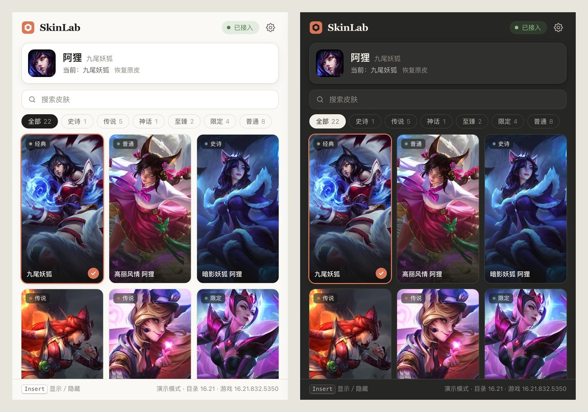

<div align="center">


# SkinLab

**A learning project on how the League of Legends client organizes character data and refreshes models**

[](https://github.com/wty92911/skinlab/actions/workflows/ci.yml)
[](https://github.com/wty92911/skinlab/releases)
[](LICENSE)

[简体中文](README.md) · English



</div>

> [!WARNING]
> - SkinLab is a personal learning and research project with public source. It is **not a commercial skin changer and offers no paid service**.
> - Visual changes are local to your machine; other players do not see them.
> - Modifying game memory **violates the League of Legends terms of service and may get your account penalized**. There is **no guarantee against bans**; you use it at your own risk.
> - If you like a skin, **please buy it in the official store** to support the game's developers.
> - **Commercial use is prohibited** (see [License](#license)).
> - Not affiliated with, endorsed by, or sponsored by Riot Games or Tencent. Game names and art belong to their respective owners.

## Features

- Detects the current champion automatically once a match loads.
- Skins shown as art cards with search and rarity filters; click to apply locally, one click to restore.
- Chromas: cards show color dots and a count. Selecting the skin unfolds a swatch row under the champion card; hover to preview the model (when the website has one), click to apply. Chromas have their own skin numbers and use the same update path.
- Ultimate forms: adapted ultimate skins get a form switcher under the champion card once applied.
- Automatically scans an unknown local EXE as data and reports its disk feature checks. Only builds verified in [`data/builds.json`](data/builds.json) connect; static matches do not establish runtime compatibility, and no component is loaded into an unverified game.
- Restores the original skin and stops the session when the window closes. <kbd>Insert</kbd> shows/hides the window.

Elementalist Lux on 16.21 is the only adapted ultimate so far (ten elements, switched manually); Air and Fire models and Q/W/E/R effects, plus restoration, were checked in Practice Tool. Its dedicated form path on 16.22 still needs validation and stays disabled when function fingerprints differ. Other ultimate and multi-form skins need per-skin engine research; unadapted ones are marked with `!` and may only apply partially. Chromas still need a Practice Tool check.

## Download

Get `SkinLab_*_x64-setup.exe` from [Releases](https://github.com/wty92911/skinlab/releases). Each release lists the supported game build, catalog version and changes, with `SHA256SUMS.txt`. The installer is unsigned and needs administrator rights; some security software may flag it because it loads a component into the game process.

## Build from source

Requires Rust stable (MSVC), x64 MinGW-w64 g++ and Node.js.

```powershell
cargo xtask native     # native components into out/session/
cargo xtask verify     # end-to-end check against SkinLab's own WARP window
cargo run -p skinlab
```

PowerShell users can also run `scripts/build-session.ps1`, which delegates to the same native build. Use `-Bundle session-dev1` while an existing match holds an older DLL; development runs and `cargo xtask verify` use the bundle selected by `out/current.json`. Installer builds use `out/session/`.

Windows development builds inherit the terminal's permissions; use an administrator terminal when connecting to the game. Release builds still request administrator rights at launch.

On macOS/Linux, `cargo run -p skinlab` starts a demo mode with an in-memory backend for UI work. See [CONTRIBUTING.md](CONTRIBUTING.md) (Chinese) and [`docs/ADAPTATION.md`](docs/ADAPTATION.md) for adapting to new game builds.

## License

[PolyForm Noncommercial License 1.0.0](LICENSE): source is available for learning, research and personal noncommercial use; **any commercial use is prohibited**. Keep the `Required Notice:` lines from `LICENSE` when redistributing. Because it restricts commercial use, this is source-available rather than OSI open source.
