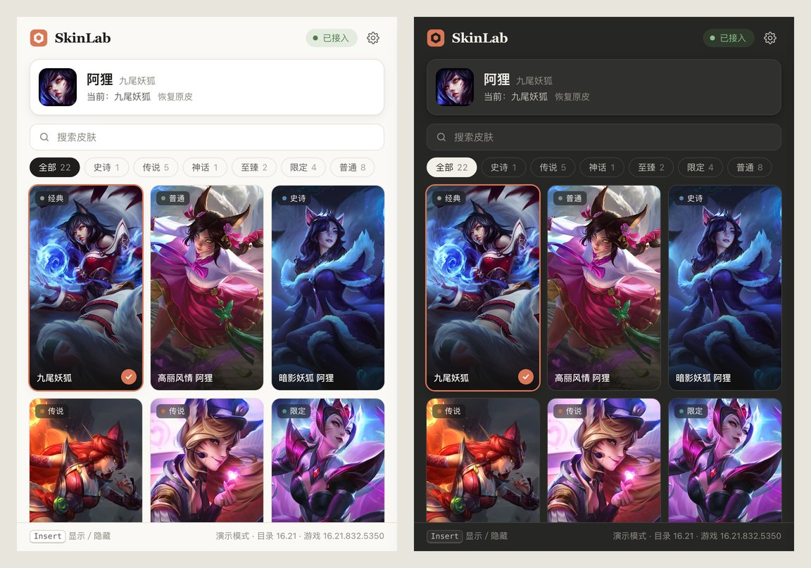

<div align="center">


# SkinLab

**英雄联盟客户端数据结构与渲染流程的学习研究项目**

[](https://github.com/wty92911/skinlab/actions/workflows/ci.yml)
[](https://github.com/wty92911/skinlab/releases)
[](LICENSE)


简体中文 · [English](README.en.md)



</div>

> [!WARNING]
> **请在使用前阅读：**
> - SkinLab 是个人学习与研究项目，源码公开，用于研究游戏客户端如何组织角色数据、如何在渲染线程刷新模型。它**不是商业换肤软件，也不提供任何付费服务**。
> - 外观改动只在你的电脑本地生效，其他玩家看不到。
> - 修改游戏内存**违反《英雄联盟》用户协议，可能导致账号受到处罚**。本项目**不提供任何免封保证**，风险由使用者自行承担。
> - 体验之后如果喜欢某款皮肤，**请在游戏内购买官方正版**，支持游戏的持续开发。
> - **禁止任何商业使用**，详见[许可](#许可)。
> - 本项目与 Riot Games、腾讯无关，亦未获其认可或赞助。“英雄联盟”及相关名称、美术资源归其各自所有者。

## 功能

- **自动识别**：进入对局后自动识别当前英雄，无需手动选择进程或输入 PID。
- **点选即生效**：皮肤以原画卡片展示，支持搜索与按稀有度筛选；点击即在本地切换，可一键恢复原皮。
- **版本保护**：只接入 [`data/builds.json`](data/builds.json) 中已完成适配验证的游戏版本；游戏更新后会提示“尚未适配”，不会加载任何组件。
- **退出即还原**：关闭窗口时先恢复原皮并停止会话。<kbd>Insert</kbd> 显示／隐藏窗口。
- **浅色／深色主题**跟随系统。

终极皮肤与多形态皮肤（如元素使、女帝）的特殊形态尚未适配，卡片上以 `!` 标注，选择后可能只有部分效果。

## 下载

从 [Releases](https://github.com/wty92911/skinlab/releases) 下载 `SkinLab_*_x64-setup.exe`。每个版本的说明都列出了它适配的游戏版本、皮肤目录版本和变更记录，并附带 `SHA256SUMS.txt` 用于校验。

- 启动时需要管理员权限（与游戏进程权限一致才能接入）。
- 安装包未做代码签名，Windows 可能提示“未知发布者”。由于程序会向游戏进程加载组件，部分安全软件可能报毒；请自行判断，可阅读源码或自行构建。

## 工作原理

```
SkinLab.exe ──stdin/stdout JSON──▶ skinlab-observe-host.exe ──共享内存命令──▶ 游戏内 skinlab-observe.dll
   (Tauri UI + 控制器)                (校验版本、加载组件)                   (特征扫描、DX11 帧线程刷新)
```

1. 通过本机 Live Client 接口（`127.0.0.1:2999`）识别当前英雄。
2. 以游戏可执行文件的 SHA256 确认版本已适配。
3. 组件在游戏进程内对代码段做特征扫描，解析出本地玩家、角色数据栈、皮肤编码参数等位置，全部唯一且回读一致才继续。
4. 换肤命令在游戏的渲染（Present）线程上执行：写入编码后的皮肤编号并调用数据栈刷新。

游戏更新后的适配方法见 [`docs/ADAPTATION.md`](docs/ADAPTATION.md)。

## 从源码构建

需要 Rust stable（MSVC）、x64 MinGW-w64 g++ 和 Node.js。

```powershell
git clone https://github.com/wty92911/skinlab.git
cd skinlab
cargo xtask native     # 编译原生组件到 out/session/
cargo xtask verify     # 用自建 WARP 窗口做端到端检查，不连接游戏
cargo run -p skinlab   # 开发运行
```

在 macOS / Linux 上也可以开发界面和控制器：`cargo run -p skinlab` 默认进入演示模式（内存后端，不启动任何进程）。更多见 [CONTRIBUTING.md](CONTRIBUTING.md)。

## 项目结构

| 路径 | 内容 |
| --- | --- |
| `crates/skinlab-core` | 皮肤目录、已适配构建、Live Client 解析、host 协议、错误分类（纯逻辑） |
| `crates/skinlab-session` | 游戏发现、构建校验、host 进程驱动、自动接入状态机 |
| `app/` | Tauri 2 外壳与界面（`app/ui`，原生 HTML/CSS/JS） |
| `xtask/` | 原生构建、fixture 验证、目录更新、发版 |
| `native/` | C++ host、会话 DLL、DX11 帧桥接、特征扫描、WARP 测试窗口 |
| `data/` | 随版本发布的皮肤目录与已适配构建 |
| `docs/` | 适配说明、后续计划 |

## 许可

本项目以 [PolyForm Noncommercial License 1.0.0](LICENSE) 发布：**源码公开，可用于学习、研究、个人非商业用途；禁止任何商业使用**，包括但不限于售卖、付费分发、收费代装、捆绑推广或作为付费服务的一部分。转发或修改须保留 `LICENSE` 中以 `Required Notice:` 开头的声明。

> 该许可限制了商业用途，因此按 OSI 的定义它属于“源码公开（source-available）”而非严格意义上的开源许可。

如需商业授权，请不要使用本项目。

## 致谢

- 皮肤名称与编号来自腾讯英雄联盟官网公开数据；原画按需从官网 CDN 加载，仓库不包含任何游戏美术资源。
- 早期研究参考了社区中公开的本地换肤实现思路。
